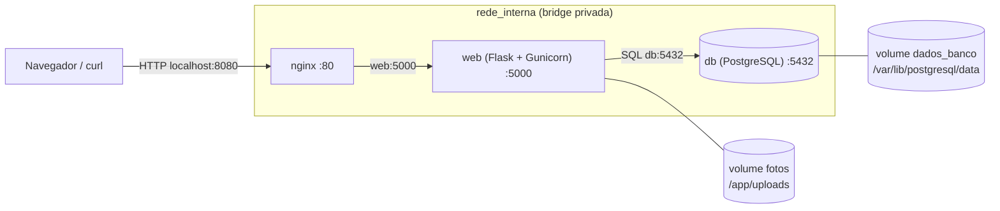

# Achados & Perdidos — ambiente em contêineres com Docker Compose

[](https://github.com/lucasetculbra/achados-perdidos-docker-compose/actions/workflows/ci-cd.yml)

Avaliação de Grau 1 · **Computação em Nuvem** · Prof. Fábio Castro · autoria: [@lucasetculbra](https://github.com/lucasetculbra)

> NOTE: **Site de documentação.** <https://lucasetculbra.github.io/achados-perdidos-docker-compose/>
> É publicado automaticamente pelo workflow de CI/CD depois que o GitHub Pages é habilitado e o primeiro push na `main` passa nos testes
> (veja [CI/CD e GitHub Pages](#cicd-e-github-pages)). O site é **só a documentação**: a aplicação roda no seu computador, com Docker.

## Objetivo

O Setor de Atendimento ao Estudante controla objetos perdidos em uma planilha. O **Achados & Perdidos** é uma pequena API web (Flask) que
cadastra e lista objetos, guarda a foto de cada um e consulta um banco PostgreSQL. Este repositório **empacota tudo em contêineres** para que
qualquer pessoa suba o ambiente completo com **um único comando**, sem perder objetos nem fotos quando os contêineres forem recriados:

```bash
docker compose up -d --build
```

O código da aplicação (`app/app.py`, `app/requirements.txt`, `db/init.sql`) é o fornecido no enunciado e **não foi alterado**; o trabalho está
no ambiente (Dockerfile, Compose, rede, volumes) e na documentação.

## Tecnologias

| Peça | Tecnologia |
|---|---|
| API | Python 3.12, Flask 3.0, psycopg 3, Gunicorn 23 (imagem própria, base `python:3.12-slim`) |
| Banco | PostgreSQL 16 (`postgres:16-alpine`) |
| Proxy reverso (bônus A) | Nginx 1.30 (`nginx:1.30-alpine`) |
| Painel do banco (bônus C) | Adminer 6 (`adminer:6.1.2`), só no profile `debug` |
| Orquestração | Docker Compose v2 (rede `bridge` definida pelo usuário, volumes nomeados, healthchecks) |
| Automação | Scripts Python (só biblioteca padrão), GitHub Actions |
| Documentação | Markdown, Mermaid, MkDocs Material → GitHub Pages |

## Arquitetura



Só o **nginx** publica porta no computador (8080). O banco e a aplicação ficam isolados na rede interna. O diagrama completo (volumes, bind mounts,
Adminer, o que fica dentro e fora da rede) está em [`docs/arquitetura.md`](docs/arquitetura.md).

> NOTE: **Versão sem o bônus do Nginx.** O enunciado básico publica o `web` diretamente (`8080:5000`). Com o **bônus do Nginx** esse mapeamento passou para o proxy (`8080:80`) e o `web` não
> publica mais porta. A versão apenas com os requisitos obrigatórios está marcada na tag Git **`base-obrigatoria`**
> (`git checkout base-obrigatoria`).

## Estrutura do repositório

```text
achados-perdidos-docker-compose/
├── app/
│   ├── app.py                  # API Flask (fornecida, sem alterações)
│   ├── requirements.txt        # dependências Python (fornecido)
│   ├── Dockerfile              # imagem do serviço web
│   └── .dockerignore           # mantém .env, __pycache__ e *.pyc fora do build
├── db/init.sql                 # cria a tabela itens + 3 itens de exemplo (fornecido)
├── nginx/default.conf          # proxy reverso (bônus A)
├── docker-compose.yml          # db, web, nginx e adminer (profile debug)
├── .env.example                # modelo de configuração (valores fictícios); o .env real NÃO é versionado
├── scripts/                    # testes, evidências e backup (Python, só biblioteca padrão)
│   ├── testar_ambiente.py      # testes funcionais + persistência + bônus (gera docs/evidencias)
│   ├── experimentos_reflexao.py# experimentos das questões Q1, Q3, Q5 e Q7
│   ├── verificar_config.py     # verificações estáticas (segredos, Dockerfile, compose, evidências)
│   ├── testar_clone_limpo.py   # repete os testes em um clone limpo (cp .env.example .env)
│   ├── backup_fotos.py         # backup/restauração do volume fotos (bônus B)
│   └── comum.py                # utilitários compartilhados
├── docs/                       # documentação (vira o site do GitHub Pages)
│   ├── index.md  guia.md  arquitetura.md  RELATORIO.md  REFLEXAO.md  bonus.md  cicd.md
│   └── evidencias/             # saídas reais dos testes, cada uma com legenda
├── .github/workflows/ci-cd.yml # CI (validar, testar, construir docs) e CD (GitHub Pages)
├── mkdocs.yml  requirements-docs.txt
└── README.md
```

<!-- --8<-- [start:passo-a-passo] -->
## Como executar

### Pré-requisitos

- **Docker** com **Docker Compose v2**: Docker Desktop (Windows/macOS) ou Docker Engine (Linux). Confira com `docker compose version`.
  Nada mais precisa ser instalado — nem Python, nem PostgreSQL.
- **Git**, para clonar, e **curl**, para testar. No PowerShell do Windows use **`curl.exe`** (o `curl` é um alias do `Invoke-WebRequest`).
- A porta **8080** livre no computador (e a **8081**, só se for usar o painel do banco).

### 1. Clonar e configurar o `.env`

```bash
git clone https://github.com/lucasetculbra/achados-perdidos-docker-compose.git
cd achados-perdidos-docker-compose
cp .env.example .env            # PowerShell: Copy-Item .env.example .env
```

Abra o `.env` e **troque a senha**. Esse arquivo é local e **nunca é versionado** (está no `.gitignore`); o `.env.example` traz as mesmas chaves com valores fictícios.

| Variável | Para que serve | Valor no `.env.example` (fictício) |
|---|---|---|
| `POSTGRES_DB` | nome do banco criado na primeira subida | `achados` |
| `POSTGRES_USER` | usuário do banco | `achados_app` |
| `POSTGRES_PASSWORD` | senha do usuário (usada pelo banco **e** pela aplicação) | `troque-esta-senha-ficticia` |

> WARNING: **A senha só vale na primeira subida.** O PostgreSQL lê `POSTGRES_PASSWORD` apenas quando o volume do banco está vazio. Trocar a senha no `.env` depois
> não muda a que já está guardada no volume, e a aplicação passa a responder `503` em `/health`. Veja "Logs e diagnóstico".

### 2. Subir o ambiente

```bash
docker compose up -d --build
docker compose ps        # db "healthy"; web e nginx "healthy"
```

O Compose constrói a imagem do `web`, sobe o banco, **espera o banco ficar saudável** (`pg_isready`), sobe o `web` e depois o `nginx`.

### 3. Testar

```bash
curl http://localhost:8080/health
curl http://localhost:8080/itens
curl "http://localhost:8080/itens?local=biblio"
curl -F descricao="Oculos de grau" -F local="Bloco B" -F foto=@oculos.jpg http://localhost:8080/itens
curl http://localhost:8080/estatisticas
docker compose logs web --tail 20
```

No PowerShell troque `curl` por `curl.exe`. Em `foto=@oculos.jpg` use o caminho de uma imagem `.jpg` ou `.png` que **exista** no seu computador.
Para ver a foto, abra no navegador `http://localhost:8080/fotos/<nome-devolvido-pelo-POST>`.

### 4. Parar e destruir

```bash
docker compose stop        # para os contêineres (nada é removido)
docker compose down        # remove contêineres e rede; os VOLUMES (itens e fotos) são mantidos
docker compose up -d       # sobe de novo: itens e fotos continuam lá
docker compose down -v     # remove TAMBÉM os volumes: itens e fotos são apagados (volta ao estado inicial)
```

<!-- --8<-- [end:passo-a-passo] -->

<!-- --8<-- [start:rotas] -->
## Rotas da API

| Método | Caminho | O que faz | Resposta esperada |
|---|---|---|---|
| `GET` | `/health` | Verifica a aplicação e a conexão com o banco | `200` `{"status":"ok","banco":"conectado","container":"<id>"}`; `503` com `"status":"erro"` se o banco estiver indisponível |
| `GET` | `/itens` | Lista os objetos, os mais recentes primeiro | `200` lista JSON com `id`, `descricao`, `local`, `foto` (`/fotos/<nome>` ou `null`) e `criado_em` |
| `GET` | `/itens?local=texto` | Filtra pelo local (contém o texto, sem diferenciar maiúsculas de minúsculas) | `200` lista filtrada, ou `[]` |
| `POST` | `/itens` | Cadastra um objeto (`multipart/form-data`: `descricao`, `local` e, opcionalmente, `foto`) | `201` `{"id":N,"foto":"<uuid>.png"}` (`foto` é `null` sem arquivo); `400` se faltar `descricao` ou `local` |
| `GET` | `/fotos/<nome>` | Devolve a foto guardada no volume | `200` com a imagem; `404` se o arquivo não existir |
| `GET` | `/estatisticas` | Total de itens no banco e de arquivos no volume de fotos | `200` `{"itens_no_banco":N,"fotos_no_volume":M}` |

O nginx recusa uploads maiores que **10 MB** (`413`) e, em `/fotos/`, adiciona `X-Content-Type-Options: nosniff`, uma `Content-Security-Policy` com `sandbox` e força o
download de qualquer arquivo que não seja imagem.
<!-- --8<-- [end:rotas] -->

## Persistência: como itens e fotos sobrevivem

Dois **volumes nomeados** guardam os dados fora dos contêineres:

| Volume | Montado em | Contém |
|---|---|---|
| `dados_banco` | `/var/lib/postgresql/data` (db) | os arquivos do PostgreSQL: tabela `itens` |
| `fotos` | `/app/uploads` (web) | as fotos enviadas |

O `db/init.sql` é montado **somente leitura** (bind mount) em `/docker-entrypoint-initdb.d/` e só é executado quando o volume do banco está **vazio**
(primeira subida ou depois de `down -v`). Como cada comando afeta os dados:

| Comando | Contêineres e rede | Volumes | Itens e fotos |
|---|---|---|---|
| `docker compose stop` / `start` | param / iniciam | mantidos | mantidos |
| `docker compose down` | removidos | **mantidos** | **mantidos** |
| `docker compose up -d` (depois de `down`) | recriados | reutilizados | continuam lá (o `init.sql` **não** roda de novo) |
| `docker compose up -d --build` | o `web` é recriado se a imagem mudou | mantidos | mantidos |
| `docker compose down -v` | removidos | **apagados** | **perdidos**; no próximo `up` o `init.sql` recria os 3 itens de exemplo |

A prova está em [`docs/evidencias/tarefa5/`](docs/evidencias/tarefa5/01-recriacao-conteineres.txt) e a explicação completa em [`docs/RELATORIO.md`](docs/RELATORIO.md) (parte D).

## Bônus

- **A — Nginx (proxy reverso):** é o único serviço com porta publicada (`8080:80`); o `web` só tem `expose: 5000`.
- **B — Backup do volume `fotos`:** `python scripts/backup_fotos.py backup` gera `backups/fotos-AAAAMMDD-HHMMSS.tar.gz` com um contêiner temporário
  (`docker run --rm`); `python scripts/backup_fotos.py restaurar --arquivo <arquivo>` restaura em um volume **novo**. Os backups podem conter fotos de pessoas:
  `backups/` e `*.tar.gz` estão no `.gitignore`.
- **C — Adminer (painel do banco):** não sobe por padrão. `docker compose --profile debug up -d` o inicia em **http://127.0.0.1:8081** (só loopback;
  sistema `PostgreSQL`, servidor `db`, usuário/senha/banco do `.env`). Para encerrar só ele: `docker compose rm -sf adminer`.

Detalhes, comandos e evidências: [`docs/bonus.md`](docs/bonus.md).

<!-- --8<-- [start:diagnostico] -->
## Logs e diagnóstico

```bash
docker compose ps                    # estado e saúde de cada serviço
docker compose logs web --tail 50    # logs da API (cada requisição aparece)
docker compose logs db               # logs do PostgreSQL (inclusive a execução do init.sql)
docker compose exec web whoami       # usuário do processo: appuser (nunca root)
docker compose exec web ls -l /app/uploads   # fotos guardadas no volume
```

| Sintoma | Causa provável | O que fazer |
|---|---|---|
| `required variable POSTGRES_... is missing a value` | não existe o arquivo `.env` | `cp .env.example .env` (PowerShell: `Copy-Item .env.example .env`) |
| `port is already allocated` / `ports are not available` na 8080 | outro programa usa a 8080 | crie um `docker-compose.override.yml` (abaixo) e acesse a nova porta |
| `/health` responde `503` com `password authentication failed` | a senha do `.env` foi trocada **depois** da primeira subida | volte a senha antiga no `.env` ou, **perdendo os dados**, `docker compose down -v` |
| `502 Bad Gateway` logo depois do `up` | o `web` ainda está iniciando | espere alguns segundos; acompanhe com `docker compose ps` |
| `413 Request Entity Too Large` | foto maior que 10 MB | use uma imagem menor ou ajuste `client_max_body_size` em `nginx/default.conf` |
| `curl` do PowerShell pede parâmetros | `curl` é alias do `Invoke-WebRequest` | use `curl.exe` |

Para trocar a porta 8080 sem editar o `docker-compose.yml`, crie (na raiz) o arquivo `docker-compose.override.yml` — ele é carregado automaticamente e está no `.gitignore`:

```yaml
services:
  nginx:
    ports: !override
      - "18080:80"
```
<!-- --8<-- [end:diagnostico] -->

## Testes automatizados e evidências

Os scripts em `scripts/` sobem um projeto Compose **isolado** (`achados-perdidos-evidencias`, com volumes e rede próprios — o `down -v` só atinge esse projeto),
executam os comandos do roteiro do enunciado com `curl`, conferem cada resultado e gravam a **saída real** de cada comando em [`docs/evidencias/`](docs/evidencias/README.md),
com uma legenda de uma linha por arquivo.

```bash
python scripts/testar_ambiente.py --evidencias docs/evidencias      # Tarefas 4 e 5, requisitos e bônus
python scripts/experimentos_reflexao.py --evidencias docs/evidencias # experimentos das questões Q1, Q3, Q5 e Q7
python scripts/verificar_config.py --final                           # segredos, Dockerfile, compose, evidências x código
python scripts/testar_clone_limpo.py                                 # tudo de novo em um clone recém-feito, com cp .env.example .env
```

Se a 8080 estiver ocupada, acrescente `--porta 18080`. O resultado de cada verificação está em [`resumo-testes.md`](docs/evidencias/resumo-testes.md) e
[`reflexao/resumo-experimentos.md`](docs/evidencias/reflexao/resumo-experimentos.md). O arquivo [`00-ambiente.txt`](docs/evidencias/00-ambiente.txt) registra as versões e o
SHA-256 dos arquivos testados; o `verificar_config.py` falha se algum deles mudar depois de gerada a evidência.

## CI/CD e GitHub Pages

O workflow [`.github/workflows/ci-cd.yml`](.github/workflows/ci-cd.yml) tem quatro jobs:

| Job | Quando | O que faz |
|---|---|---|
| `validar` | push e PR na `main`, execução manual | `.env` fora do Git, verificações estáticas, `docker compose config`, hadolint (Dockerfile), actionlint (workflow), gitleaks (segredos) |
| `testes` | depois de `validar` | cria um `.env` efêmero com senha aleatória, sobe o ambiente e roda os testes funcionais, de persistência e dos bônus e os experimentos; guarda as evidências como artefato |
| `docs` | depois de `validar` | `mkdocs build --strict`; em push na `main`, empacota o site para o Pages |
| `deploy` | **somente** push na `main`, depois de `testes` e `docs` | publica o site no GitHub Pages (permissões `pages: write` e `id-token: write`, ambiente `github-pages`) |

O Pages hospeda **apenas a documentação**; a aplicação (Flask/PostgreSQL) é validada pela CI via Docker. Nenhum segredo é necessário.

**Habilitar a publicação (uma vez, pelo dono do repositório):** `GitHub → Settings → Pages → Build and deployment → Source → GitHub Actions`. Depois faça o push na `main` e
acompanhe em **Actions**; ao final do job `deploy`, o endereço aparece no ambiente `github-pages`. Se o push vier antes de habilitar o Pages, o job `deploy` falha na etapa
*Configurar o Pages* — habilite e use **Re-run jobs**. Mais detalhes em [`docs/cicd.md`](docs/cicd.md).

## Segurança e limitações

- **Senhas:** nada no `Dockerfile`, no `docker-compose.yml`, no código ou nos workflows; tudo vem do `.env` (não versionado). A CI usa um `.env` efêmero com senha aleatória mascarada nos logs.
- **Isolamento:** o banco **não** publica porta (confirmado em [`complementares/02`](docs/evidencias/complementares/02-portas-publicadas.txt)); o `web` roda como `appuser` (UID 10001), com sistema de
  arquivos somente leitura, sem *capabilities* e com `no-new-privileges`.
- **A API é pública e sem autenticação, e o tráfego é HTTP puro** — adequado a um protótipo local. Antes de publicar na nuvem são necessários TLS e controle de acesso (veja Q6 em
  [`docs/REFLEXAO.md`](docs/REFLEXAO.md)).
- **Fotos podem conter dados pessoais** (carteira de estudante, RG): a LGPD exige minimização, controle de acesso e prazo de retenção — medidas que este protótipo ainda não implementa.
- **O `app.py` não valida o tipo nem o tamanho do upload** (e não deve ser alterado nesta atividade); o nginx mitiga parte do risco (limite de 10 MB, `nosniff`, CSP e download forçado de arquivos que não são imagem).
- **Não escala horizontalmente como está:** o volume `fotos` é local a uma máquina e há um único banco, sem backup automático (Q7).

## Checklist de entrega

| Item do enunciado | Situação | Onde está a prova |
|---|---|---|
| `docker compose up -d --build` funciona em pasta recém-clonada, após copiar `.env.example` para `.env` | ✅ | [`clone-limpo.txt`](docs/evidencias/clone-limpo.txt), [`tarefa4/01`](docs/evidencias/tarefa4/01-docker-compose-up.txt) |
| `GET /health` retorna `ok` e `conectado` | ✅ | [`tarefa4/03`](docs/evidencias/tarefa4/03-health.txt) |
| Nenhuma senha no Dockerfile, no `docker-compose.yml` ou no repositório | ✅ | `scripts/verificar_config.py` (também roda na CI), gitleaks (executado localmente; roda na CI), [`complementares/05`](docs/evidencias/complementares/05-sem-segredos-na-imagem.txt) |
| O banco não publica porta no host | ✅ | [`complementares/02`](docs/evidencias/complementares/02-portas-publicadas.txt) |
| `docker compose exec web whoami` não retorna `root` | ✅ (`appuser`) | [`complementares/01`](docs/evidencias/complementares/01-usuario-nao-root.txt) |
| Itens e fotos sobrevivem a `down` + `up` | ✅ | [`tarefa5/01`](docs/evidencias/tarefa5/01-recriacao-conteineres.txt) |
| README com passo a passo testado do zero | ✅ | [`clone-limpo.txt`](docs/evidencias/clone-limpo.txt) |
| Diagrama com rede, volumes e portas | ✅ | [`docs/arquitetura.md`](docs/arquitetura.md) |
| Relatório técnico com as partes (a) a (d) | ✅ | [`docs/RELATORIO.md`](docs/RELATORIO.md) |
| Evidências nomeadas e legendadas | ✅ | [`docs/evidencias/`](docs/evidencias/README.md) |
| Sete questões respondidas e tabela de equivalência em nuvem | ✅ | [`docs/REFLEXAO.md`](docs/REFLEXAO.md) |
| Bônus A, B e C | ✅ | [`docs/bonus.md`](docs/bonus.md) |
