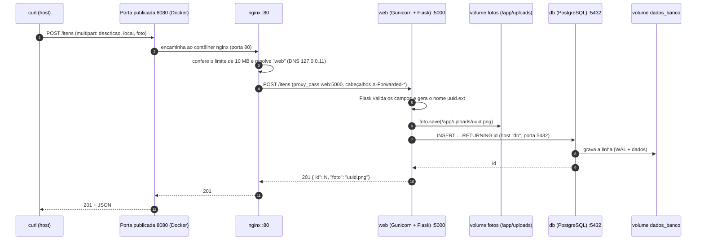

# Relatório técnico

Este relatório explica **como e por que** cada peça do ambiente funciona, na ordem do enunciado: (A) Dockerfile, (B) `docker-compose.yml`,
(C) o caminho de uma requisição `POST /itens` com foto e (D) o ciclo de vida dos volumes. Os números e as mensagens citadas vêm das
[evidências](evidencias/README.md), geradas pelos scripts do repositório a partir do código entregue.

## A. Dockerfile

O arquivo [`app/Dockerfile`](https://github.com/lucasetculbra/achados-perdidos-docker-compose/blob/main/app/Dockerfile) gera a imagem do serviço `web`:

```dockerfile
# Imagem do serviço "web" (API Flask servida pelo Gunicorn).
# A ordem das instruções vai do que muda menos para o que muda mais,
# para aproveitar o cache de camadas (ver docs/RELATORIO.md, parte A).
FROM python:3.12-slim

# Sem arquivos .pyc, logs sem buffer (aparecem na hora em `docker compose logs`)
# e sem o aviso de versão do pip.
ENV PYTHONDONTWRITEBYTECODE=1 \
    PYTHONUNBUFFERED=1 \
    PIP_DISABLE_PIP_VERSION_CHECK=1

WORKDIR /app

# Usuário sem privilégios (RNF04) e diretório de uploads pertencente a ele.
# O UID/GID fixo (10001) deixa a permissão previsível dentro do volume "fotos".
RUN groupadd --system --gid 10001 appuser \
 && useradd --system --uid 10001 --gid appuser --no-create-home --shell /usr/sbin/nologin appuser \
 && mkdir -p /app/uploads \
 && chown appuser:appuser /app/uploads

# Dependências primeiro: esta camada só é refeita se o requirements.txt mudar.
COPY requirements.txt .
RUN pip install --no-cache-dir -r requirements.txt

# Código por último: muda com frequência e invalida só as camadas abaixo dele.
COPY app.py .

# UID:GID numérico (o mesmo do appuser): plataformas como o Kubernetes só
# conseguem verificar "não é root" quando o usuário é numérico.
USER 10001:10001

EXPOSE 5000

CMD ["gunicorn", "--bind", "0.0.0.0:5000", "--workers", "2", "--access-logfile", "-", "app:app"]
```

### Instrução por instrução

| # | Instrução | O que faz | Por que assim |
|---|---|---|---|
| 1 | `FROM python:3.12-slim` | Parte da imagem **oficial** do Python 3.12, variante *slim* (Debian enxuto). | Traz Python e `pip` sem compiladores nem documentação: menos para baixar, menos superfície de ataque. É a base pedida no enunciado. O `docker image ls` mostra a base com 179 MB em disco (45,4 MB de conteúdo) e a imagem final com 206 MB (50,4 MB): as dependências somam só ~27 MB ([`complementares/07`](evidencias/complementares/07-docker-image-ls.txt)). |
| 2 | `ENV PYTHONDONTWRITEBYTECODE=1 PYTHONUNBUFFERED=1 PIP_DISABLE_PIP_VERSION_CHECK=1` | Desliga a gravação de `.pyc`, desliga o *buffer* da saída e a consulta de versão do `pip`. | Sem `.pyc` o código roda bem num sistema de arquivos somente leitura. Sem *buffer*, o que o Python escreve aparece na hora em `docker compose logs`. Sem a consulta do `pip`, o build não faz uma requisição de rede à toa. |
| 3 | `WORKDIR /app` | Cria e define `/app` como diretório de trabalho. | Os `COPY` seguintes são relativos a ele, e `/app/uploads` é o diretório de fotos que o `app.py` usa por padrão (`UPLOAD_DIR`). |
| 4 | `RUN groupadd … && useradd … && mkdir -p /app/uploads && chown …` | Cria o grupo e o usuário `appuser` (UID/GID **10001**, sem *home* e sem *shell*), cria `/app/uploads` e entrega a pasta a esse usuário. | É o requisito **RNF04**: o processo não pode ser root. O UID fixo deixa a permissão previsível. Tudo em um `RUN` gera **uma** camada. Como esta etapa quase nunca muda, fica antes do código. O `chown` importa também para o volume: ao montar o volume `fotos` **vazio** em `/app/uploads`, o Docker copia para ele o conteúdo e o dono do diretório da imagem, então o `appuser` consegue gravar. |
| 5 | `COPY requirements.txt .` | Copia **só** a lista de dependências. | A camada passa a depender apenas desse arquivo: enquanto ele não mudar, o Docker reaproveita tudo até aqui. |
| 6 | `RUN pip install --no-cache-dir -r requirements.txt` | Instala Flask, psycopg (com a biblioteca do PostgreSQL embutida, `psycopg[binary]`) e Gunicorn. | `--no-cache-dir` não deixa o cache de *wheels* na imagem (menor). O `psycopg[binary]` dispensa instalar `gcc` e `libpq-dev`. Roda como root, **antes** do `USER`: os pacotes ficam no sistema e o `appuser` não consegue alterá-los. |
| 7 | `COPY app.py .` | Copia o código da aplicação. | É o que mais muda, então vem por último e só invalida as camadas **abaixo** dele. O arquivo fica de dono root: o `appuser` o lê, mas não o modifica. |
| 8 | `USER 10001:10001` | A partir daqui, e em tempo de execução, o processo roda como `appuser`. | Um UID **numérico** permite que plataformas como o Kubernetes comprovem que o contêiner não é root. Prova: `docker compose exec web whoami` → `appuser` ([`complementares/01`](evidencias/complementares/01-usuario-nao-root.txt)). |
| 9 | `EXPOSE 5000` | Registra na imagem que a aplicação escuta na porta 5000. | É **documentação**: não publica porta nenhuma. Quem publica é o Compose (aqui, o `nginx` acessa o `web:5000` pela rede interna). |
| 10 | `CMD ["gunicorn", "--bind", "0.0.0.0:5000", "--workers", "2", "--access-logfile", "-", "app:app"]` | Inicia o Gunicorn (servidor WSGI de produção) com 2 *workers*, escutando em todas as interfaces **do contêiner**, e registra cada requisição na saída padrão. | A **forma exec** (com colchetes) não usa *shell*: o Gunicorn vira o processo 1 e recebe o `SIGTERM` do `docker compose stop`, encerrando com calma. `0.0.0.0` é necessário para que *outros contêineres* alcancem a porta (não a expõe ao host). `--access-logfile -` faz cada requisição aparecer em `docker compose logs web`. `app:app` = módulo `app.py`, objeto `app`. |

### O `.dockerignore`

[`app/.dockerignore`](https://github.com/lucasetculbra/achados-perdidos-docker-compose/blob/main/app/.dockerignore) exclui `.env`, `__pycache__/`, `*.pyc`, ambientes virtuais, `.git/`, `uploads/` e documentação.
Dois efeitos: **nenhum segredo entra no contexto de build** (nem na imagem) e o contexto fica minúsculo — o BuildKit transferiu apenas ~2,5 kB (`transferring context: 2.48kB`
em [`q5-cache-de-camadas.txt`](evidencias/reflexao/q5-cache-de-camadas.txt)).

### Por que esta ordem aproveita o cache de camadas

O Docker guarda o resultado de cada instrução como uma **camada** e a reaproveita se a instrução e os arquivos que ela usa não mudaram. Quando uma camada muda, **ela e todas as
seguintes** são refeitas. Por isso a ordem é *do que muda menos para o que muda mais*: sistema e usuário → dependências → código. Medido com builds reais (cada um sobre uma cópia
limpa de `app/`, sem mexer nos arquivos do repositório):

| Build | `RUN pip install` | `COPY app.py` | Tempo medido |
|---|---|---|---|
| Do zero (`--no-cache`) | executado | executado | 13,1 s |
| Nada mudou | `CACHED` | `CACHED` | 1,5 s |
| **Só o `app.py` mudou** | **`CACHED`** | refeito | **2,5 s** |
| O `requirements.txt` mudou | refeito | refeito | 11,8 s |

Os tempos dependem da máquina e da rede; o que não muda é o padrão `CACHED`/refeito, conferido automaticamente pelo experimento
([`reflexao/q5-cache-de-camadas.txt`](evidencias/reflexao/q5-cache-de-camadas.txt) e a resposta da [Q5](REFLEXAO.md#q5-cache-de-camadas-do-dockerfile)).
Se o `COPY app.py` viesse **antes** do `pip install`, qualquer mudança no código reinstalaria todas as dependências.

## B. `docker-compose.yml`

O arquivo [`docker-compose.yml`](https://github.com/lucasetculbra/achados-perdidos-docker-compose/blob/main/docker-compose.yml) descreve o ambiente inteiro. Bloco a bloco:

### Cabeçalho e variáveis do `.env`

| Trecho | Explicação |
|---|---|
| `name: achados-perdidos` | Nome do **projeto**: é o prefixo dos recursos criados (`achados-perdidos_fotos`, `achados-perdidos_rede_interna`…). Os testes usam outro nome (`achados-perdidos-evidencias`), o que os mantém **isolados** do ambiente real. |
| `${POSTGRES_DB:?mensagem}` e iguais | O Compose lê o arquivo `.env` da pasta do projeto e **interpola** os valores no YAML — nenhuma senha fica escrita no `docker-compose.yml` (RNF03). O `:?` faz o comando **falhar logo**, com uma mensagem clara, se a variável não existir. |
| Interpolação × `env_file` | Aqui o `.env` serve só para interpolar. Ele **não** é entregue inteiro aos contêineres (`env_file` faria isso): cada serviço recebe apenas as variáveis de que precisa. |

> WARNING: **Segredos e docker inspect.** As variáveis de ambiente de um contêiner aparecem em `docker inspect` para quem tem acesso ao Docker. Em um servidor compartilhado ou na nuvem, o certo é usar
> um cofre de segredos (veja a tabela de equivalência na [Reflexão](REFLEXAO.md#51-do-ambiente-local-para-a-nuvem)).

### Serviço `db`

| Trecho | Explicação |
|---|---|
| `image: postgres:16-alpine` | Imagem **oficial** do PostgreSQL 16 sobre Alpine (pedida no enunciado). |
| `environment: POSTGRES_DB/USER/PASSWORD` | Variáveis que a imagem usa **na primeira inicialização** para criar o banco e o usuário. Depois disso, o PostgreSQL guarda a senha no volume (por isso trocar o `.env` depois não a altera). |
| `volumes: dados_banco:/var/lib/postgresql/data` | **Volume nomeado** com os arquivos do banco: sobrevive à recriação do contêiner. |
| `volumes: ./db/init.sql:/docker-entrypoint-initdb.d/init.sql:ro` | **Bind mount somente leitura** do script. O *entrypoint* da imagem executa os arquivos dessa pasta **apenas quando o diretório de dados está vazio**. `:ro` impede o contêiner de alterar o arquivo do repositório (comprovado: `Read-only file system` em [`complementares/04`](evidencias/complementares/04-sistema-de-arquivos-somente-leitura.txt)). |
| `healthcheck: pg_isready -h 127.0.0.1 -U "$${POSTGRES_USER}" -d "$${POSTGRES_DB}"` | Marca o contêiner como `healthy` só quando o PostgreSQL **aceita conexões**. O `$$` impede que o Compose interpole: quem expande a variável é o *shell* do contêiner. O `-h 127.0.0.1` força conexão **TCP**: na primeira subida o *entrypoint* roda um servidor temporário que escuta só no socket Unix; sem o `-h`, o teste passaria cedo demais, antes do `init.sql` terminar e do servidor de verdade subir. |
| `interval: 5s`, `timeout: 5s`, `retries: 12`, `start_period: 10s` | Testa a cada 5 s; falhas durante os 10 s iniciais não contam; só marca `unhealthy` depois de 12 falhas seguidas. |
| `restart: unless-stopped` | Reinicia o contêiner se ele cair e quando o Docker/computador reinicia, **exceto** se você o parou de propósito (`docker compose stop`). |
| `networks: rede_interna` e **nenhum `ports`** | O banco só é alcançável como `db:5432` dentro da rede. Prova: `db: {"5432/tcp":null}` em [`complementares/02`](evidencias/complementares/02-portas-publicadas.txt). |

### Serviço `web`

| Trecho | Explicação |
|---|---|
| `build: ./app` | Constrói a imagem a partir do `Dockerfile` da pasta `app/` (a imagem se chama `<projeto>-web`). |
| `DB_HOST: db`, `DB_PORT: "5432"` | O nome `db` é resolvido pelo DNS embutido do Docker (veja a [Q1](REFLEXAO.md#q1-por-que-o-nome-db-funciona-no-lugar-de-um-ip)). |
| `DB_NAME`, `DB_USER`, `DB_PASSWORD` | Vêm das **mesmas** três variáveis `POSTGRES_*`: a credencial é definida em **um só lugar** e o `web` e o `db` nunca discordam. |
| `UPLOAD_DIR: /app/uploads` | Diretório das fotos (é o padrão do `app.py`, aqui explícito). |
| `expose: "5000"` | Documenta a porta interna. **Não publica**: o `web` só é alcançado pelo `nginx`, pela rede. |
| `volumes: fotos:/app/uploads` | **Volume nomeado** das fotos. |
| `depends_on: db: condition: service_healthy` | O `web` só **inicia** depois que o `db` estiver `healthy` — não apenas "iniciado" (RNF05). Na saída real: `db-1 Healthy` aparece **antes** de `web-1 Starting` ([`tarefa4/01`](evidencias/tarefa4/01-docker-compose-up.txt)). |
| `healthcheck` (Python + `urllib`) | Consulta `GET /health` dentro do contêiner (a imagem não tem `curl`). Permite que o `nginx` espere o `web` ficar saudável. |
| `read_only: true` + `tmpfs: /tmp` | O sistema de arquivos do contêiner fica **somente leitura**; só `/app/uploads` (volume) e `/tmp` (memória, usado pelo Gunicorn e pelo Flask para uploads grandes) aceitam escrita. |
| `cap_drop: [ALL]` + `no-new-privileges` | Remove todas as *capabilities* do Linux e impede ganhar privilégios. A aplicação não precisa de nenhuma. |
| `restart: unless-stopped` | Como no `db`. |

A prova do endurecimento está em [`complementares/04`](evidencias/complementares/04-sistema-de-arquivos-somente-leitura.txt): `touch /app/teste-gravacao` → `Read-only file system`, enquanto gravar em `/app/uploads` funciona.

### Serviço `nginx` (bônus A)

| Trecho | Explicação |
|---|---|
| `image: nginx:1.30-alpine` e `ports: "8080:80"` | Único serviço com porta publicada: a 8080 do computador vai para a 80 do `nginx`. |
| `volumes: ./nginx/default.conf:…:ro` | Configuração do proxy, montada somente leitura. |
| `depends_on: web: condition: service_healthy` | Só sobe depois do `web` saudável (ordem **db → web → nginx**). |
| `healthcheck` com `wget …/health` | Passa **pelo proxy até o `web` e o banco**, validando a cadeia inteira. |

O [`nginx/default.conf`](https://github.com/lucasetculbra/achados-perdidos-docker-compose/blob/main/nginx/default.conf) faz quatro coisas: (1) `resolver 127.0.0.11 valid=10s` + `proxy_pass` por variável, para resolver o nome `web` **em tempo de execução**
(o proxy continua funcionando quando o `web` é recriado e distribui entre réplicas — [Q7](REFLEXAO.md#q7-docker-compose-up-d-scale-web3)); (2) `client_max_body_size 10m`, porque o padrão do Nginx (1 MB) rejeitaria fotos comuns;
(3) cabeçalhos `X-Forwarded-*` para a aplicação saber quem é o cliente real; (4) em `/fotos/`, `nosniff`, uma `Content-Security-Policy` com `sandbox` e `Content-Disposition: attachment` para tudo que **não** for imagem,
porque o `app.py` aceita qualquer arquivo como "foto" (um `.html` enviado poderia executar *scripts* no site). Prova: [`bonus/02`](evidencias/bonus/02-nginx-upload-grande.txt) (2 MB passa, 11 MB recebe `413`) e
[`bonus/03`](evidencias/bonus/03-nginx-fotos-cabecalhos-de-seguranca.txt) (o `.html` é baixado; o PNG é exibido).

### Serviço `adminer` (bônus C)

`profiles: ["debug"]` mantém o serviço **fora** do `docker compose up` comum; `ports: "127.0.0.1:8081:8080"` o publica só em *loopback*; `ADMINER_DEFAULT_SERVER: db` já preenche o servidor; e ele alcança o
banco pela rede interna — o PostgreSQL continua sem porta publicada.

### Rede e volumes

| Trecho | Explicação |
|---|---|
| `networks: rede_interna: driver: bridge` | Rede **definida pelo usuário** compartilhada por todos os serviços. É ela que dá o **DNS por nome** (`db`, `web`) e isola o conjunto do host. Prova: `docker network inspect` com os três contêineres e seus IPs em [`complementares/06`](evidencias/complementares/06-docker-network-inspect.txt). |
| `volumes: dados_banco: / fotos:` | Declara os dois **volumes nomeados**. O Compose os cria com o prefixo do projeto e os **mantém** entre `down` e `up`; só `down -v` os remove. |

## C. O caminho de um `POST /itens` com foto

Exemplo real: `curl -F descricao="Oculos de grau" -F local="Bloco B" -F foto=@oculos.png http://localhost:8080/itens` — a saída está em
[`tarefa4/06-cadastro-com-foto.txt`](evidencias/tarefa4/06-cadastro-com-foto.txt).



1. **O cliente monta a requisição.** O `curl -F` cria um corpo `multipart/form-data` com três partes (`descricao`, `local`, `foto`) separadas por um *boundary*, e envia
   `POST /itens` para `localhost:8080`.
2. **A porta publicada.** A 8080 do computador é a única porta publicada do ambiente; o Docker encaminha a conexão TCP para a porta 80 do contêiner `nginx`, na `rede_interna`.
3. **O `nginx` recebe.** Confere o tamanho (`client_max_body_size 10m`; acima disso responde `413` sem incomodar a aplicação) e guarda o corpo da requisição em *buffer*.
4. **O `nginx` escolhe o destino.** O `proxy_pass` usa o nome `web`; o `nginx` o resolve pelo DNS embutido do Docker (`127.0.0.11`) para o IP do contêiner `web` (válido por 10 s) e abre uma conexão para
   `web:5000`, acrescentando `Host`, `X-Real-IP` e `X-Forwarded-For/Proto`. Esta porta **não** existe fora da rede interna.
5. **O Gunicorn entrega ao Flask.** Um dos 2 *workers* (processos filhos do mestre, que compartilham a porta 5000) aceita a conexão e a transforma em uma chamada WSGI. O Flask roteia `POST /itens` para a função `cadastrar()`.
6. **O Flask lê o formulário.** Campos de texto vão para `request.form`; o arquivo vai para `request.files["foto"]` (acima de ~500 KB o Werkzeug o guarda em `/tmp`, por isso o `tmpfs`).
7. **Validação.** Sem `descricao` ou sem `local`, a resposta é `400` (comprovado em [`tarefa4/07`](evidencias/tarefa4/07-cadastro-sem-foto-e-validacao.txt)).
8. **O nome do arquivo.** O nome original é **descartado**: só a extensão é mantida e o arquivo se chama `uuid4().hex + extensão` (ex.: `0d30f0ef…png`). Isso evita colisões e impede *path traversal*.
9. **A foto vai para o disco.** `foto.save("/app/uploads/<uuid>.png")` escreve em `/app/uploads`, que é o volume `fotos` (no Docker Desktop, em `/var/lib/docker/volumes/<projeto>_fotos/_data`, dentro da VM).
   O processo é o `appuser`, dono da pasta; o resto do sistema de arquivos é somente leitura.
10. **Conexão com o banco.** `psycopg.connect("host=db port=5432 dbname=… user=… password=…")` usa as variáveis `DB_*` do ambiente. O nome `db` é resolvido pelo mesmo DNS interno e a conexão TCP vai ao
    PostgreSQL pela rede interna.
11. **Gravação dos metadados.** `INSERT INTO itens (descricao, local, foto) VALUES (%s, %s, %s) RETURNING id` — com **parâmetros** (sem concatenar texto, logo sem injeção de SQL). O PostgreSQL escreve
    no diretório de dados, que é o volume `dados_banco`, e preenche `criado_em` com `NOW()`.
12. **Confirmação.** Ao sair do bloco `with`, o psycopg faz o `COMMIT` e fecha a conexão; `fetchone()[0]` já guardou o `id` gerado.
13. **A resposta volta.** O Flask devolve `201` com `{"id": N, "foto": "<uuid>.png"}`; o Gunicorn registra a linha de acesso em `docker compose logs web` ([`tarefa4/11`](evidencias/tarefa4/11-logs-web.txt)); a resposta percorre
    `web → nginx → porta publicada → curl`.
14. **Depois.** `GET /fotos/<uuid>.png` lê o mesmo arquivo do volume (`send_from_directory`), e `GET /itens` mostra o item com `"foto": "/fotos/<uuid>.png"`.

> NOTE: **Limitação do código fornecido.** A foto é gravada **antes** do `INSERT`. Se o banco falhar nesse ponto, o arquivo fica órfão no volume (o `app.py` não desfaz a gravação). É uma limitação do código fornecido, que não deve ser alterado nesta atividade.

## D. Ciclo de vida dos volumes

Os volumes têm vida **independente** dos contêineres: são criados na primeira subida e só desaparecem se você mandar. A Tarefa 5 comprovou o comportamento em três situações; as contagens
abaixo vêm de `GET /estatisticas` registrado **antes** de cada passo.

| Situação | O que o Docker faz | Itens / fotos | Prova |
|---|---|---|---|
| **Primeira subida** (`up -d --build`) | Cria rede, volumes e contêineres. O volume `dados_banco` está vazio, então o `init.sql` roda e cria a tabela e os **3 itens de exemplo**. O volume `fotos` é criado com o dono do diretório da imagem. | 3 itens / 0 fotos | [`tarefa4/01`](evidencias/tarefa4/01-docker-compose-up.txt), [`tarefa4/04`](evidencias/tarefa4/04-itens.txt) |
| **`docker compose down` + `up -d`** | `down` remove contêineres e rede, mas **mantém** os volumes (`docker volume ls` ainda lista os dois). O `up` recria os contêineres e os **reanexa** aos mesmos volumes; o `init.sql` **não** roda. | **7 itens / 3 fotos antes e 7 / 3 depois**; a lista de itens e o SHA-256 das 3 fotos são idênticos | [`tarefa5/01`](evidencias/tarefa5/01-recriacao-conteineres.txt) |
| **Inspeção** (`docker volume ls`/`inspect`) | Mostra `achados-perdidos-evidencias_dados_banco` e `…_fotos` (driver `local`). O `Mountpoint` é `/var/lib/docker/volumes/<nome>/_data`, **dentro da VM do Docker**; no Linux nativo é um diretório do próprio host. Nunca é a pasta do projeto. | `ls -l /app/uploads` lista as 3 fotos, do `appuser` | [`tarefa5/02`](evidencias/tarefa5/02-inspecao-volumes.txt) |
| **`docker compose down -v`** + `up -d` | O `-v` **apaga** os volumes. O novo `dados_banco` nasce vazio e o `init.sql` roda de novo (log: `running /docker-entrypoint-initdb.d/init.sql`, `CREATE TABLE`, `INSERT 0 3`). O novo `fotos` nasce vazio. | **3 itens / 0 fotos** (só os de exemplo); a foto antiga devolve `404` | [`tarefa5/03`](evidencias/tarefa5/03-remocao-volumes.txt) |

**Por que o `down -v` "zera" tudo.** Os itens cadastrados viviam no volume `dados_banco` e as fotos no volume `fotos`; ao removê-los, os dados vão junto. Como o diretório de dados do PostgreSQL voltou a
ficar vazio, o *entrypoint* da imagem trata a subida como **primeira execução** e roda o `init.sql`, que recria os três itens de exemplo. Já os itens e fotos que o usuário cadastrou **não têm como voltar**,
a menos que exista backup (bônus B, em [Bônus](bonus.md)).

**Outros fatos do ciclo de vida:**

- `docker compose stop`/`start` e `restart` não tocam nos volumes.
- Reconstruir a imagem (`up -d --build`) troca só o código do `web`; os volumes seguem iguais.
- Mudar o `init.sql` **depois** da primeira subida não tem efeito, porque o volume já está populado (experimento em [`reflexao/q3`](evidencias/reflexao/q3-init-sql-alterado.txt) e [Q3](REFLEXAO.md#q3-alterar-o-initsql-depois-da-primeira-subida)).
- O que apaga dados **sem querer**: `docker compose down -v`, `docker volume rm`, `docker volume prune` e `docker system prune --volumes`. Faça backup antes (`scripts/backup_fotos.py`).
- O volume é **local a uma máquina**: contêineres em outro servidor não o enxergam ([Q7](REFLEXAO.md#q7-docker-compose-up-d-scale-web3)).
