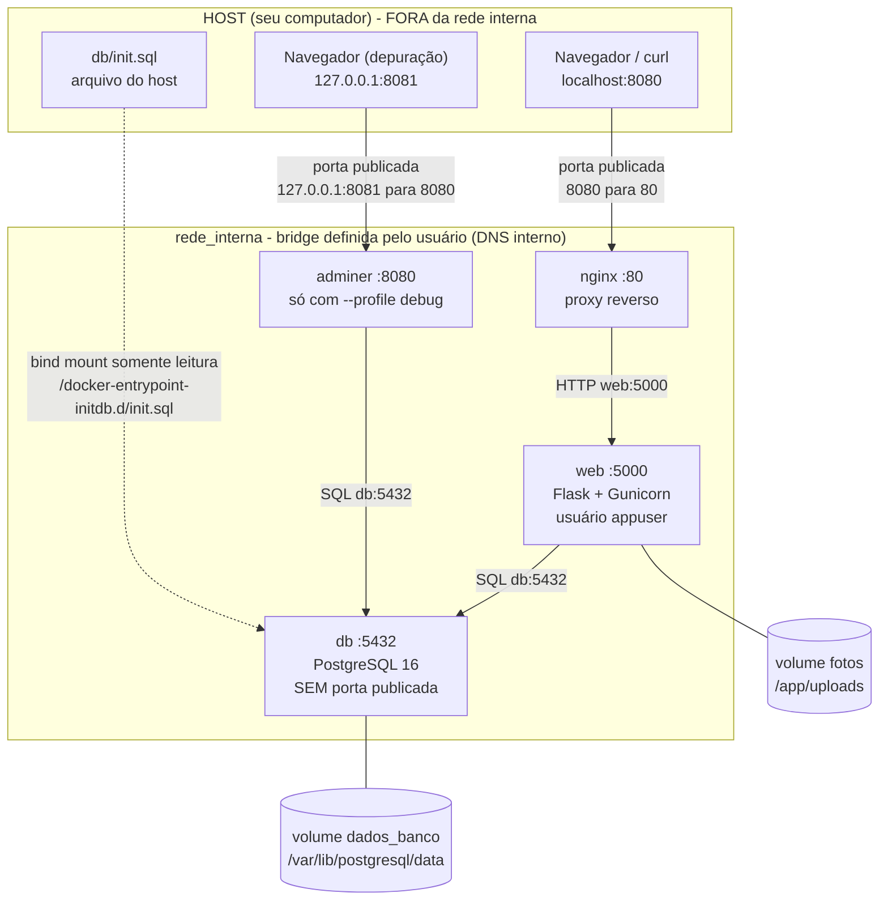
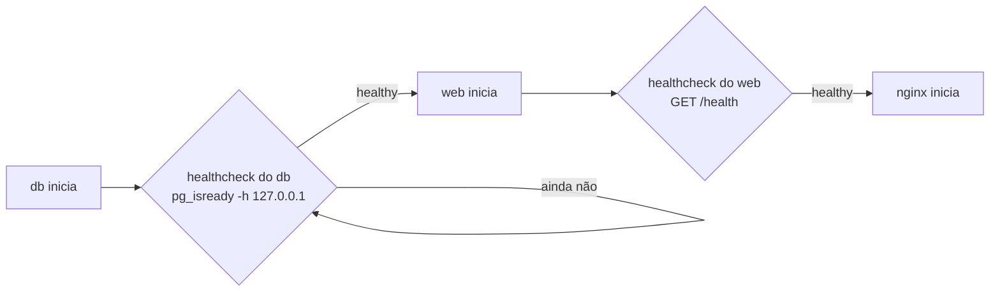

# Arquitetura

O ambiente tem **quatro serviços** (`nginx`, `web`, `db` e, só em depuração, `adminer`), **uma rede privada** (`rede_interna`) e **dois volumes nomeados**
(`dados_banco` e `fotos`). Apenas o `nginx` é acessível a partir do computador (*host*); o banco e a aplicação ficam isolados na rede interna.

## Diagrama

> NOTE: **Como ler o diagrama.** Setas contínuas são tráfego de rede; linhas cheias sem seta ligam um serviço ao volume que ele usa; a seta **tracejada** é o *bind mount* somente leitura do `init.sql` (o `nginx/default.conf` é montado do mesmo modo; veja a tabela de volumes).
> A porta `5432` do banco e a `5000` do `web` **não** são publicadas no host.

## O que fica dentro e fora da rede interna

| Fora da rede (no host) | Dentro da rede `rede_interna` |
|---|---|
| Navegador e `curl` do usuário | `nginx` (porta 80), `web` (5000), `db` (5432) e, em depuração, `adminer` (8080) |
| Os arquivos `db/init.sql` e `nginx/default.conf` (viram bind mounts somente leitura) | Resolução de nomes pelo DNS embutido do Docker (`127.0.0.11`): `web` encontra `db`, o `nginx` encontra `web` |
| O `.env` (lido pelo Compose; as variáveis chegam aos contêineres, o arquivo não) | Tráfego `nginx → web → db` e `adminer → db`, invisível para fora |
| O daemon do Docker, que guarda os volumes | Os contêineres enxergam os volumes apenas como diretórios montados |

A **fronteira** entre os dois lados são as portas publicadas:

| Origem | Destino | Porta | Publicada no host? |
|---|---|---|---|
| Navegador / `curl` | `nginx` | `8080` → `80` | **Sim** (`0.0.0.0:8080`) — o único ponto de entrada |
| Navegador | `adminer` | `127.0.0.1:8081` → `8080` | Sim, **só em loopback** e **só** com `--profile debug` |
| `nginx` | `web` | `5000` | Não (somente rede interna) |
| `web` | `db` | `5432` | **Não** |
| `adminer` | `db` | `5432` | **Não** |

Prova de que só o `nginx` publica porta: [`complementares/02-portas-publicadas.txt`](evidencias/complementares/02-portas-publicadas.txt) mostra
`db: {"5432/tcp":null}`, `web: {"5000/tcp":null}` e o `nginx` ligado à porta do host.

## Componentes

| Componente | Tipo | Imagem | Responsabilidade |
|---|---|---|---|
| `nginx` | serviço | `nginx:1.30-alpine` | Proxy reverso. Único com porta publicada. Limita uploads a 10 MB e protege as respostas de `/fotos/`. |
| `web` | serviço | construída de `./app` (`python:3.12-slim`) | API Flask servida pelo Gunicorn na porta 5000. Consulta o banco e grava as fotos no volume `fotos`. Roda como `appuser`, com sistema de arquivos somente leitura. |
| `db` | serviço | `postgres:16-alpine` | PostgreSQL com a tabela `itens`, criada na primeira execução pelo `init.sql`. |
| `adminer` | serviço (profile `debug`) | `adminer:6.1.2` | Painel web do banco, só para depuração. |
| `rede_interna` | rede `bridge` | — | Rede privada com DNS por nome; isola `db` e `web` do host. |

## Volumes e *bind mounts*

| Nome | Tipo | Montado em | Serviço | Conteúdo | Ciclo de vida |
|---|---|---|---|---|---|
| `dados_banco` | volume nomeado | `/var/lib/postgresql/data` | `db` | arquivos do PostgreSQL (tabela `itens`) | sobrevive a `down`; some com `down -v` |
| `fotos` | volume nomeado | `/app/uploads` | `web` | fotos enviadas (`<uuid>.<ext>`) | sobrevive a `down`; some com `down -v` |
| `./db/init.sql` | bind mount **somente leitura** | `/docker-entrypoint-initdb.d/init.sql` | `db` | script de criação da tabela e dos 3 itens de exemplo | só é executado quando `dados_banco` está vazio |
| `./nginx/default.conf` | bind mount **somente leitura** | `/etc/nginx/conf.d/default.conf` | `nginx` | configuração do proxy | lida na inicialização do nginx |

Os volumes ficam gerenciados pelo Docker (`/var/lib/docker/volumes/<projeto>_<nome>/_data`, dentro da VM do Docker Desktop no Windows/macOS) — veja
[`tarefa5/02-inspecao-volumes.txt`](evidencias/tarefa5/02-inspecao-volumes.txt). Como cada comando do Compose afeta esses dados: [Relatório, parte D](RELATORIO.md#d-ciclo-de-vida-dos-volumes).

## Ordem de inicialização

O `depends_on` com `condition: service_healthy` garante a ordem **db → web → nginx**: cada serviço só inicia quando o anterior está realmente pronto, não apenas "iniciado".
A saída real de `docker compose up -d --build` mostra essa sequência em [`tarefa4/01-docker-compose-up.txt`](evidencias/tarefa4/01-docker-compose-up.txt).

> NOTE: **Versão sem o bônus do Nginx.** O enunciado básico publica o `web` direto (`8080:5000`) e não tem `nginx`. Essa versão está na tag Git `base-obrigatoria`.
> O diagrama acima já é o da versão final, em que o `nginx` é a única porta de entrada.
