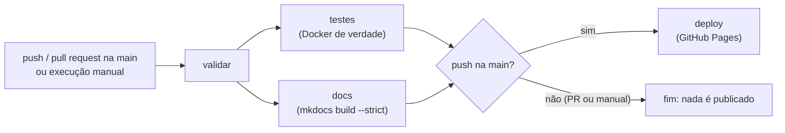

# CI/CD e GitHub Pages

O workflow [`.github/workflows/ci-cd.yml`](https://github.com/lucasetculbra/achados-perdidos-docker-compose/blob/main/.github/workflows/ci-cd.yml) valida o ambiente a cada alteração (**CI**) e publica esta documentação no GitHub Pages (**CD**) — mas só
depois de os testes passarem.

> WARNING: **O Pages hospeda só a documentação** (HTML estático gerado a partir de `docs/`). A aplicação Flask/PostgreSQL **não** roda no Pages: ela é validada na CI, dentro de contêineres Docker, e roda no computador de quem a usa.

## Visão geral



| Evento | `validar` | `testes` | `docs` | `deploy` |
|---|---|---|---|---|
| `push` na `main` | ✅ | ✅ | ✅ (e empacota o site) | ✅ só depois de `testes` e `docs` |
| `pull_request` para a `main` | ✅ | ✅ | ✅ (só constrói) | ❌ **nunca** publica |
| `workflow_dispatch` (manual) | ✅ | ✅ | ✅ (só constrói) | ❌ |

## Jobs

| Job | O que faz |
|---|---|
| **`validar`** | (1) falha se o `.env` estiver versionado ou fora do `.gitignore`; (2) `scripts/verificar_config.py --final`: código fornecido intacto, nenhuma senha escrita, Dockerfile, estrutura do compose e se as **evidências correspondem ao código atual**; (3) `docker compose config` com e sem `--profile debug`; (4) **hadolint** no Dockerfile; (5) **actionlint** no próprio workflow; (6) **gitleaks** no histórico do Git. |
| **`testes`** | Cria um `.env` **efêmero** com senha aleatória (mascarada nos logs), roda `scripts/testar_ambiente.py` (endpoints, persistência `down`/`up` e `down -v`, `whoami`, banco sem porta, bônus A, B e C) e `scripts/experimentos_reflexao.py` (Q1, Q3, Q5, Q7). Cada verificação **falha o job** se não for atendida. As evidências da execução ficam no artefato `evidencias-ci`. O ambiente de teste é sempre removido (`if: always()`). |
| **`docs`** | Instala `requirements-docs.txt` e roda `mkdocs build --strict` (qualquer aviso, como link quebrado, reprova). Em `push` na `main`, empacota a pasta `site/` com `actions/upload-pages-artifact`. |
| **`deploy`** | Só em `push` na `main`, e só depois de `testes` e `docs`. `actions/configure-pages` + `actions/deploy-pages`, no ambiente `github-pages`. |

## Permissões e segurança

- `permissions: contents: read` no nível do workflow: os jobs só leem o código. **Apenas o job `deploy`** pede `pages: write` e `id-token: write` (publicar no Pages e comprovar a origem por OIDC).
- **Nenhum segredo** é necessário: a CI usa um `.env` criado na hora, com senha aleatória, e o `::add-mask::` a esconde dos logs.
- O artefato publicado contém **apenas** o site gerado (`site/`): sem `.env`, sem código de execução, sem banco. As evidências publicadas usam imagens sintéticas (degradês), sem pessoas ou documentos, e os scripts conferem que elas não contêm a senha nem caminhos do computador.
- `concurrency` cancela execuções antigas de pull requests e **não** cancela um deploy em andamento.

## Como habilitar a publicação (uma vez)

1. No GitHub, abra o repositório → **Settings** → **Pages**.
2. Em **Build and deployment** → **Source**, escolha **GitHub Actions**.
3. Faça o push na `main` (ou use **Actions → CI/CD → Run workflow** na `main` e depois um push). Acompanhe em **Actions**.
4. Ao terminar o job `deploy`, o endereço aparece no ambiente `github-pages`: `https://lucasetculbra.github.io/achados-perdidos-docker-compose/`.

Se o push acontecer **antes** de habilitar o Pages, só o job `deploy` falha, na etapa *Configurar o Pages* (os testes continuam válidos). Habilite o Pages e use **Re-run failed jobs**.

> NOTE: **Resultado das execuções.** Esta documentação não registra o resultado das execuções no GitHub: ele muda a cada push. Consulte a aba **Actions** e o selo de status no [README](https://github.com/lucasetculbra/achados-perdidos-docker-compose#readme).

## Reproduzir a CI no seu computador

Os mesmos comandos do workflow rodam localmente (com Docker e Python 3):

```bash
python scripts/verificar_config.py --final
docker compose --env-file .env.example config --quiet
docker run --rm -i hadolint/hadolint:v2.15.1 < app/Dockerfile
docker run --rm -v "$PWD:/repo" -w /repo rhysd/actionlint:1.7.12
docker run --rm -v "$PWD:/repo" zricethezav/gitleaks:v8.30.1 git /repo --no-banner --redact
python scripts/testar_ambiente.py --evidencias docs/evidencias      # use --porta 18080 se a 8080 estiver ocupada
python scripts/experimentos_reflexao.py --evidencias docs/evidencias
pip install -r requirements-docs.txt && mkdocs build --strict
```

## Por que as evidências do repositório e as da CI são diferentes

As evidências em `docs/evidencias/` são geradas **no computador do autor**, contra o código entregue, e entram no repositório (e neste site). A CI gera as suas **de novo** a cada execução, em um
ambiente limpo, e as guarda como artefato — assim a prova não depende de confiança no computador de quem entrega. O passo `verificar_config.py --final` impede que as evidências versionadas fiquem para trás: ele compara o
SHA-256 dos arquivos de infraestrutura registrado em [`00-ambiente.txt`](evidencias/00-ambiente.txt) com o atual e **reprova** se algum mudou depois de gerada a evidência.
